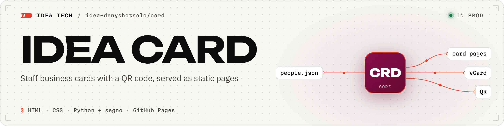
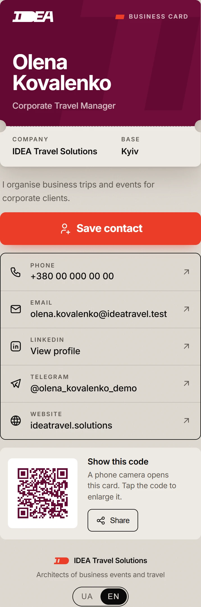
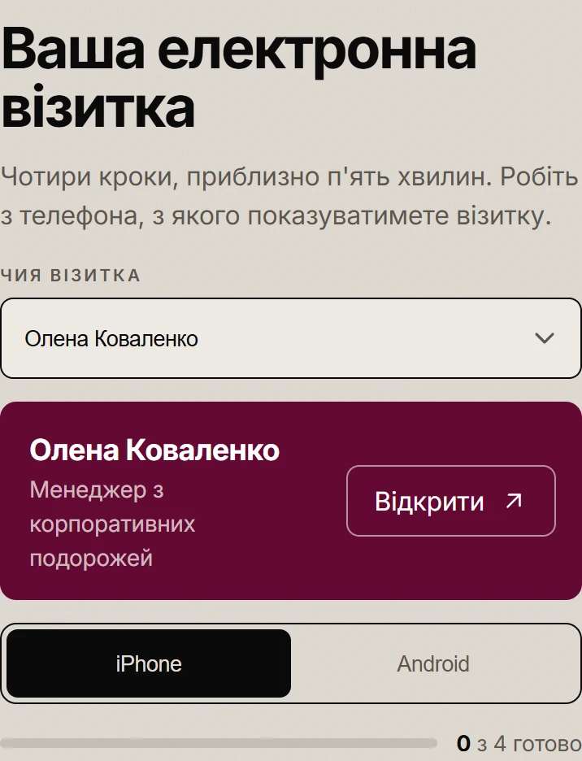

<picture>
  <source media="(prefers-color-scheme: dark)" srcset="docs/img/banner-dark.webp">
  
</picture>

Staff business cards for IDEA Travel Solutions: a branded page, vCard and QR code per person, built from one JSON file.

> [!IMPORTANT]
> Add or change people only in `_src/people.json`, then run `uv run _src/build.py` and commit what it generates.
> The pages are build output. The phone generator from the first prototype (`card-site.zip`) still makes the old
> design, and uploading its archive overwrites every card.

**Documents:** [Architecture](docs/ARCHITECTURE.md) · [Contributing](CONTRIBUTING.md) · [Person template](_src/person.example.json)

<picture>
  <source media="(prefers-color-scheme: dark)" srcset="docs/img/card-dark.webp">
  
</picture>

<sup>Demo data: `scripts/demo_people.json`, domains `*.test`.</sup>

## What it does

- **Builds** one folder per person from [`_src/people.json`](_src/people.json): `index.html`, `contact.vcf`
  (Ukrainian), `contact.en.vcf` (English) and `manifest.webmanifest`. Code: [build.py](_src/build.py).
- **Draws the QR code at build time** with `segno`, as inline SVG. The code holds only the page URL, so a new phone
  number or title never means reprinting it or reissuing a wallet pass.
- **Follows the reader's language:** Ukrainian for `uk` and `ru` browsers, English for the rest. Names, titles and
  the saved contact switch with it; `?lang=en` forces English. Code: [prepaint.js](_src/prepaint.js).
- **Saves the contact in one tap** as vCard 3.0 with the CRLF line endings RFC 2426 requires, and opens the QR code
  full screen on tap, for scanning across a table.
- **Colours each card** with an IDEA palette theme: `burgundy` (company default), `green` or `black`, each with a
  dark mode. `?theme=green` previews another colour without changing the card.
- **Walks staff through setup** at `guide/?p=<slug>`: home-screen shortcut, Apple Wallet through WalletWallet with
  a copy button per field, Google Wallet through a branded image drawn in the browser. Code: [guide.js](_src/guide.js).
- **Publishes on every push to `main`:** GitHub Actions copies the built pages, never `_src/`, into the public
  [`idea-denyshotsalo/team`](https://github.com/idea-denyshotsalo/team) repo as one commit without history.
  Code: [publish.yml](.github/workflows/publish.yml).

## Quick start

Needs [uv](https://docs.astral.sh/uv/). The demo site uses only made-up data and leaves the real pages alone:

```bash
uv run scripts/demo_site.py --serve
```

```console
$ uv run scripts/demo_site.py --serve
built olena-kovalenko
built guide
built landing
CNAME cards.ideatravel.test
serving .demo on http://127.0.0.1:8000/olena-kovalenko/
```

To change the real site, edit `_src/people.json` (copy [`person.example.json`](_src/person.example.json) for a new
colleague) and rebuild in place:

```bash
uv run _src/build.py
```

Commit the JSON together with every file the build changed, in one PR.

## In action

Each colleague gets a link to the guide filled in with their own card, `guide/?p=<slug>`:

<picture>
  <source media="(prefers-color-scheme: dark)" srcset="docs/img/guide-dark.webp">
  
</picture>

<sup>Demo data.</sup>

"Save contact" on the English page downloads this file, here from the demo build:

```text
$ cat .demo/olena-kovalenko/contact.en.vcf
BEGIN:VCARD
VERSION:3.0
N:Kovalenko;Olena;;;
FN:Olena Kovalenko
ORG:IDEA Travel Solutions
TITLE:Corporate Travel Manager
TEL;TYPE=CELL:+380000000000
EMAIL;TYPE=INTERNET:olena.kovalenko@ideatravel.test
URL:https://linkedin.com/in/olena-kovalenko-demo
URL:https://t.me/olena_kovalenko_demo
URL:https://ideatravel.solutions
ADR;TYPE=WORK:;;;Kyiv;;;
NOTE:I organise business trips and events for corporate clients.
END:VCARD
```

The Ukrainian page serves `contact.vcf` with the same fields in Ukrainian.

## Configuration

Everything lives in `_src/people.json`:

| Key | What it does |
|---|---|
| `site` | Base URL of the pages. QR codes encode `site` + slug; a host outside `github.io` also writes `CNAME` |
| `company.theme` | Default card colour: `burgundy`, `green` or `black` |
| `company.contact` | Who the guide tells people to message when their details change |
| `people[].slug` | Folder and URL path. `""` puts the card at the root; with no root card the build writes a landing page there |
| `people[].first`, `last`, `title`, `city`, `bio` | `{"uk": …, "en": …}`; `city` and `bio` are optional |
| `people[].phone`, `email` | Contact rows; Ukrainian numbers are shown as `+380 XX XXX XX XX` |
| `people[].links` | Optional `linkedin`, `telegram`, `instagram` and `github` URLs |
| `people[].theme` | Colour for one person, overriding `company.theme` |

## Deployment

Merging into `main` publishes within about a minute, in two places for now:

- this repo's own GitHub Pages, `https://idea-denyshotsalo.github.io/card/`;
- the copy that `publish.yml` pushes to `idea-denyshotsalo/team`, served at `https://idea-denyshotsalo.github.io/team/`.

`team` is meant to take over at `team.ideatravel.solutions` once DNS is in place, and this repo then goes private.
The steps are in [docs/ARCHITECTURE.md](docs/ARCHITECTURE.md#custom-domain).

> [!WARNING]
> The workflow builds nothing; it only copies files. A PR that changes `people.json` without the regenerated pages
> publishes the old cards.

## Limits

- **Everything on a card is public.** Add only colleagues who agreed to publish their phone and email. While this
  repo is public, its history keeps every entry that was ever removed.
- **Removing a person takes two steps:** delete their entry and run `git rm -r <slug>`. The build writes folders but
  never prunes old ones.
- **No backend.** The pages have no analytics, cookies or forms; the chosen language and the guide progress stay in
  the visitor's `localStorage`.
- **This repo makes no wallet passes.** Apple Wallet accepts only signed `.pkpass` files, so the guide sends people
  to WalletWallet, a free third-party service. Google Wallet takes a picture of the QR code.
- **The brand display face, PP Neue Machina, is commercial, so the repo does not ship it.** Pages use Inter (SIL OFL
  1.1), the brand's body face.

## Contributing

Through PRs only, see [CONTRIBUTING.md](CONTRIBUTING.md). The screenshots in this README come from the demo data;
re-shoot them with `uv run scripts/screenshots.py`, which drives the installed Google Chrome.
